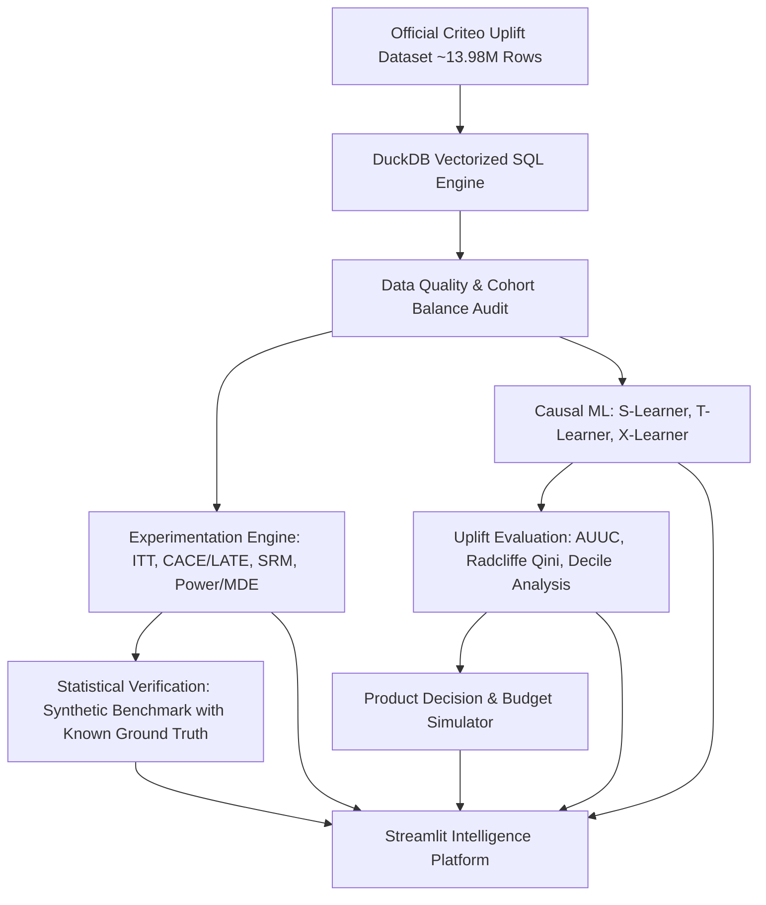

# ⚡ Product Growth & Experimentation Intelligence Platform
### Research-Grade Causal Inference, Uplift Modeling & Decision Economics on the Criteo Benchmark

[](https://www.python.org/downloads/)
[](tests/)
[](https://duckdb.org/)
[](https://lightgbm.readthedocs.io/)
[](https://streamlit.io/)
[](LICENSE)

---

## 1. Objective & Platform Overview
This platform is a complete, reproducible, research-quality causal inference and experimentation system built to analyze randomized marketing interventions, estimate heterogeneous treatment effects (HTE), and optimize targeting policies under realistic business constraints.

Using the official **Criteo Uplift Prediction Dataset** (~13.98 million records), the platform bridges classical **Randomized Controlled Trial (A/B testing)** statistical rigor with modern **Causal Machine Learning (Uplift Modeling)** and **Strategic Decision Simulation**.



---

## 2. Key Empirical Findings & Results

All results below are evaluated on the strictly held-out test partition ($N = 75,000$ users) of the Criteo dataset:

### A/B Experimentation & Causal Inference
* **Primary Conversion Rate**: Control = **0.2167%**, Treatment = **0.3146%**
* **Absolute Lift (ITT)**: **+0.0979 percentage points** (95% CI: `[+0.0451%, +0.1507%]`, $z = 3.1921$, $p = 1.41 \times 10^{-3}$)
* **Relative Lift (Delta Method)**: **+45.18%** (95% CI: `[+15.31%, +82.78%]`)
* **Complier Average Causal Effect (CACE / LATE)**: **+2.7211 percentage points** (95% CI: `[+1.2572%, +4.1851%]`, $p = 2.69 \times 10^{-4}$) among compliers who actually received ad impressions (compliance rate: 3.60%).

### Causal Machine Learning Benchmark

| Model Architecture | Radcliffe Qini Score | AUUC Metric | Mean Pred Lift | Top Decile Lift |
| :--- | :---: | :---: | :---: | :---: |
| **T-Learner (LightGBM)** | **+12.87** | **+15.03** | +0.0009 | **+0.84%** |
| **X-Learner (LightGBM)** | **+8.97** | **+10.38** | +0.0007 | **+0.84%** |
| **Baseline ATE** | -9.10 | -10.71 | +0.0009 | +0.09% |
| **S-Learner (LightGBM)** | -16.75 | -19.70 | +0.0006 | +0.04% |

* **Concentration of Responders**: In Decile 1 (top 10% highest predicted uplift), the observed incremental lift is **+0.8437%** (2.054% treatment vs 1.210% control), whereas Deciles 2 through 9 exhibit near-zero lift.

### Strategic Product Economics ($V = \$50, C = \$0.10, B = \$15,000$)
* **Break-Even Conversion Lift**: $\tau^* = \frac{\$0.10}{\$50.00} = \mathbf{0.20\%}$ (20 basis points).
* **Treat All (Indiscriminate)**: Targets 100% of users $\to$ Costs $\$7,500.00$, generates $\$3,789.37$ $\to$ **Net Loss: $-\$3,710.63$ (-49.48% ROI)**.
* **Optimal Model-Guided Policy**: Targets top 10% highest-responding users $\to$ Costs $\$750.00$, generates $\$3,163.98$ $\to$ **Net Profit: $+\$2,413.98$ (+321.86% ROI)**.

### Statistical Verification (Known Ground Truth)
* **A/A False Positive Rate (Null)**: Empirical FPR = **6.67%** at nominal $\alpha = 5\%$ ($p = 0.3447$).
* **95% Confidence Interval Coverage**: Empirical coverage = **98.00%** across Monte Carlo trials.
* **X-Learner Ground Truth Recovery**: Spearman rank correlation with true CATE = **0.6466**, PEHE RMSE = **0.0399**.

---

## 3. Tech Stack & Architecture
* **Data Processing & SQL**: [DuckDB](https://duckdb.org/) (out-of-core streaming and SQL queries), Apache Parquet, Pandas, NumPy.
* **Causal Inference & Experimentation**: SciPy (asymptotic normal, Wald IV, Chi-squared, Delta Method), Scikit-learn.
* **Causal Machine Learning**: [LightGBM](https://lightgbm.readthedocs.io/) (gradient boosted trees), Logistic Regression, Künzel et al. X-Learner, T-Learner, S-Learner.
* **Interactive Dashboard**: [Streamlit](https://streamlit.io/) with custom dark/navy glassmorphism theme and real-time parameter simulation.
* **Verification & Testing**: Pytest, automated Monte Carlo simulation suites.

---

## 4. Repository Structure

```
├── config/
│   └── config.yaml               # Experiment, data, model, and economic parameters
├── data/
│   ├── raw/                      # Downloaded official Criteo dataset archive (.csv.gz)
│   └── processed/                # High-speed ZSTD-compressed Apache Parquet sample
├── queries/                      # Reproducible DuckDB SQL scripts
│   ├── 01_data_quality_audit.sql
│   ├── 02_cohort_summary.sql
│   ├── 03_srm_check.sql
│   └── 04_feature_transforms.sql
├── src/
│   ├── data_pipeline/            # Ingestion, streaming, quality audit, compound splitting
│   ├── experimentation/          # A/B testing, ITT, CACE/LATE, SRM, sequential peeking risk
│   ├── power_analysis/           # Power calculations, MDE curves, sample size sizing
│   ├── uplift_models/            # Causal ML learners: Baseline ATE, S/T/X-Learners, Cross-Fitting
│   ├── policy_eval/              # Uplift metrics: AUUC, Radcliffe Qini, Decile Lift, Decision Simulator
│   ├── simulation/               # Synthetic verification: known ground truth CATE, bias, CI coverage
│   └── reporting/                # Publication figures and visual asset generator
├── scripts/                      # Deterministic CLI runners
│   ├── prepare_data.py           # Ingestion and DuckDB reservoir sampling
│   ├── run_experiment_analysis.py# A/B testing, SRM, CACE, and MDE runner
│   ├── run_uplift_models.py      # Uplift modeling and decision simulator runner
│   ├── run_synthetic_benchmarks.py# Synthetic ground truth verification runner
│   └── generate_all_reports.py   # Master pipeline orchestrator
├── dashboard/
│   └── app.py                    # Interactive multi-tab Streamlit intelligence platform
├── tests/                        # 21 unit & statistical tests
│   ├── test_data_pipeline.py
│   ├── test_experimentation.py
│   ├── test_uplift_models.py
│   ├── test_policy_eval.py
│   └── test_synthetic_verification.py
├── docs/
│   ├── figures/                  # Generated high-resolution publication charts (fig1 - fig8)
│   ├── reports/                  # Exported JSON metrics and CSV result tables
│   ├── model_card.md             # Model Card (Mitchell et al.)
│   ├── methodology.md            # Statistical & causal inference foundations
│   └── technical_report.md       # Full technical report
├── pyproject.toml
└── README.md
```

---

## 5. Quick Start & Execution Guide

### Prerequisites
* Python 3.9+ (Python 3.10 recommended)
* `uv` or standard `pip`

### Step 1: Environment Setup
```bash
# Clone the repository and navigate into it
cd "Credit Risk Intelligence"

# Create a virtual environment
python3 -m venv .venv
source .venv/bin/activate

# Install the package in editable mode with all dependencies
pip install -e .
```

### Step 2: Run End-to-End Pipeline
Executes data quality checks, A/B experiment inference, CACE estimation, causal ML models, decision simulation, and synthetic ground truth verification:
```bash
python scripts/generate_all_reports.py
```

### Step 3: Run Unit & Statistical Tests
```bash
pytest -v
```
*(All 21 unit tests pass in under 3 seconds).*

### Step 4: Launch Interactive Streamlit Dashboard
```bash
streamlit run dashboard/app.py
```
Open [http://localhost:8501](http://localhost:8501) in your browser.

---

## 6. Detailed Methodology & Documentation
* **Methodology Guide**: See [docs/methodology.md](docs/methodology.md) for full mathematical derivations of ITT, CACE via Wald IV, Delta Method standard errors, Radcliffe Qini curves, and Lan-DeMets alpha-spending functions.
* **Model Card**: See [docs/model_card.md](docs/model_card.md) for details on estimators, compound stratified splitting, bias benchmarks, and limitations.
* **Technical Report**: See [docs/technical_report.md](docs/technical_report.md) for full empirical analysis and failure mode post-mortems.

---

## 7. Scientific Integrity & Non-Negotiable Rules
* **No Fabricated Data**: All experimental metrics and cohort distributions are computed directly from genuine Criteo dataset records.
* **Clear Attribution**: Economic figures are explicitly identified as `[SIMULATED SCENARIO]` and separated from observed data.
* **Counterfactual Humility**: Individual treatment effects are never treated as observable ground truth. Policy evaluations use strictly held-out test splits with bootstrap confidence intervals.
